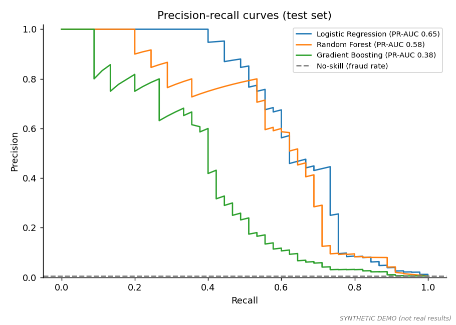
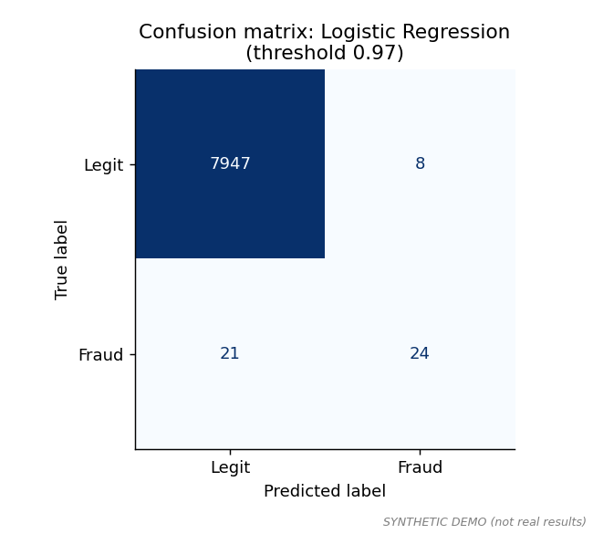
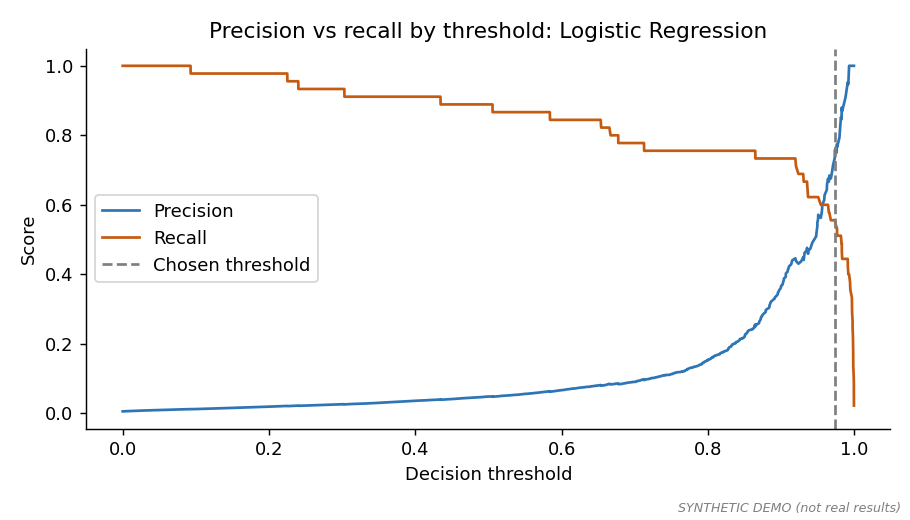
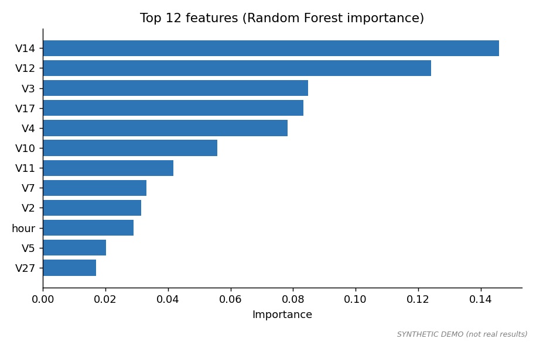

# Credit Card Fraud Detection (Python + Machine Learning)

A machine-learning project that detects fraudulent card transactions in **highly imbalanced data** (fraud is a tiny fraction of
transactions), and reports results in business terms: how much fraud is caught and how many false alerts it costs.



> Charts and numbers in this repo come from the **synthetic demo data**. Run the project on the real Kaggle file
> (steps below), then commit the new `outputs/` folder and update the findings.

## Business problem
Fraud is rare but costly. A model that flags too little misses fraud; one that flags too much annoys customers and floods analysts.
The goal is to catch as much fraud as possible at an acceptable number of false alerts.

## Approach
| Step | What and why |
|------|--------------|
| Imbalance | A "never fraud" baseline gets about 99.8% accuracy, so **accuracy is not used**. Models are compared on **PR-AUC**, precision and recall |
| Split | Stratified 60% train / 20% validation / 20% test, so each part keeps the same fraud rate |
| Leakage control | Scaling is fitted inside a pipeline; the decision threshold is chosen on the **validation** set, never the test set |
| Class imbalance | Fraud rows get a higher training weight (balanced sample weights) instead of copying or inventing rows |
| Models | Logistic Regression (simple baseline), Random Forest, Gradient Boosting, plus a dummy baseline |
| Threshold | Chosen to maximise F1 on validation, with a trade-off chart so the business can pick a different balance |
| Business view | Share of fraud **value** caught and false alerts per 1,000 transactions |

## Quick start
```bash
git clone https://github.com/vigneshm8198-afk/creditcard-fraud-ml.git
cd creditcard-fraud-ml
pip install -r requirements.txt
python src/train.py
```
Outputs: `outputs/metrics.csv`, `outputs/findings.md` (auto summary with a results table), `outputs/charts/*.png`, and the saved model in `models/`.
With no real data present it uses the synthetic demo. For real results see [data/README.md](data/README.md).

**Score new transactions** with the saved model:
```bash
python src/predict.py --input new_transactions.csv --output scored.csv
```
(needs columns `Time`, `V1`..`V28`, `Amount`; adds `fraud_probability` and `flagged_as_fraud`).

## Charts
| | |
|---|---|
|  |  |
|  | |

## Results (fill in from your run on the real data)
Copy the table from `outputs/findings.md` here, and write 3 to 4 sentences: which model won, its precision and recall,
the share of fraud value caught, and the false-alert rate.

| Model | PR-AUC | Precision | Recall | Fraud value caught | False alerts / 1,000 |
|---|---|---|---|---|---|
| _fill in_ | | | | | |

## Recommendations (adapt to your results)
- Use the tuned threshold, not 0.5, and let the fraud team move it using the trade-off chart.
- Send high-probability cases to automatic block and mid-probability cases to manual review.
- Retrain regularly, since fraud patterns change.

## Assumptions and limits
- The real features V1 to V28 are anonymised, so the model cannot be explained in business terms beyond feature importance.
- The real data covers only two days and uses a **random** split. In production you would split by time to avoid looking into the future.
- With only 492 frauds, test results are noisy: a few missed cases change recall noticeably. Treat small differences between models with care.
- Fraud-value-caught uses transaction amounts only and ignores investigation costs.
- Demo results are from synthetic data and say nothing about real performance.

## Project structure
```
creditcard-fraud-ml/
├── README.md
├── requirements.txt
├── LICENSE
├── .gitignore
├── data/README.md            # where to get the real data
├── src/
│   ├── make_sample_data.py   # synthetic demo data
│   ├── train.py              # train, evaluate, charts, save model
│   └── predict.py            # score new transactions
├── models/                   # saved model (not committed)
└── outputs/                  # metrics.csv, findings.md, charts/
```

## Author
Vignesh M | Data Analytics | Chennai
